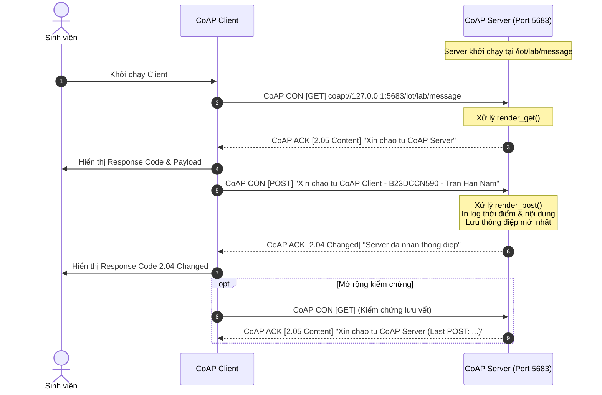
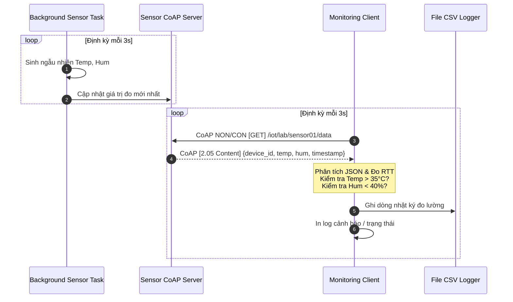
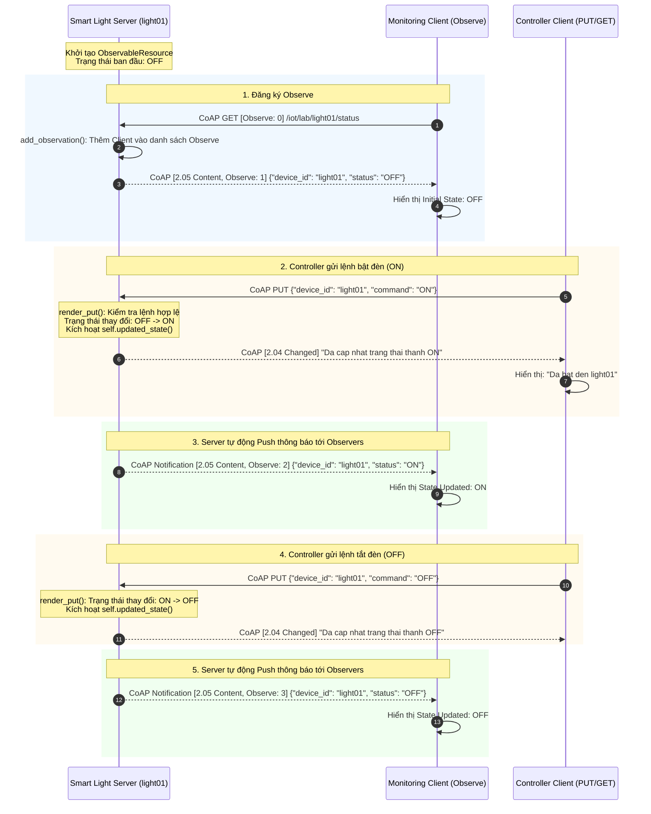

# BÁO CÁO THỰC HÀNH IoT - BÀI THỰC HÀNH CoAP (Constrained Application Protocol)

**Môn học:** Lập trình / Thực hành IoT  
**Nhóm thực hiện:**  
- Trần Hán Nam - B23DCCN590  
- Đàm Tiến Thành - B23DCCN764  
- Nguyễn Hoàng Long - B23DCCN504  

**Thư mục bài tập:** `coap_lab_b3` (hoặc `coap`)  

---

# I. MÔI TRƯỜNG VÀ CÀI ĐẶT CHUNG

### 1. Giới thiệu tổng quan về giao thức CoAP
**CoAP (Constrained Application Protocol - RFC 7252)** là giao thức truyền thông chuyên biệt dành cho các thiết bị IoT bị giới hạn nghiêm ngặt về tài nguyên tính toán (vi điều khiển, cảm biến, RAM/ROM thấp) và hoạt động trên các mạng truyền thông băng thông hẹp, độ trễ cao, dễ mất gói (Low-power and Lossy Networks - LLNs).

- **Mô hình hoạt động:** CoAP kế thừa mô hình RESTful tương tự HTTP (GET, POST, PUT, DELETE) nhưng chạy trên nền giao thức truyền tải **UDP** (User Datagram Protocol) với cổng mặc định là **5683**.
- **Cấu trúc 2 tầng (Two-layer approach):**
  1. *Tầng Thông điệp (Messaging layer):* Quản lý độ tin cậy thông qua 4 loại thông điệp: **CON** (Confirmable - yêu cầu ACK), **NON** (Non-confirmable - không cần ACK), **ACK** (Acknowledgement), **RST** (Reset - từ chối hoặc báo lỗi).
  2. *Tầng Yêu cầu / Phản hồi (Request/Response layer):* Ánh xạ các phương thức REST (GET/POST/PUT) và mã trạng thái CoAP (ví dụ: `2.05 Content`, `2.04 Changed`, `4.00 Bad Request`, `4.04 Not Found`).
- **Header siêu nhẹ:** Header CoAP cố định chỉ gồm 4 byte (so với hàng trăm byte header của HTTP qua TCP), giúp tiết kiệm tối đa năng lượng và băng thông vô tuyến.
- **Cơ chế CoAP Observe (RFC 7641):** Cho phép Client đăng ký theo dõi (Subscribe) một tài nguyên trên Server. Khi tài nguyên thay đổi trạng thái, Server sẽ chủ động gửi thông báo (Server Push Notification) mà Client không cần phải gửi yêu cầu GET thăm dò định kỳ (Polling).

---

### 2. Phiên bản Python và các thư viện sử dụng
- **Phiên bản Python:** Python 3.10+ (Đã kiểm thử và chạy ổn định trên Python 3.13 64-bit).
- **Thư viện chính:**
  - `aiocoap` (Phiên bản `0.4.17`): Thư viện bất đồng bộ chuẩn (`asyncio`) cho Python triển khai đầy đủ các tính năng của CoAP client/server, tài nguyên có thể quan sát (`ObservableResource`), xử lý định dạng nội dung JSON và quản lý phiên CoAP.
- **Thư viện chuẩn (Python Standard Library):**
  - `asyncio`: Xử lý I/O bất đồng bộ, điều khiển vòng lặp sự kiện, non-blocking input console.
  - `json`: Đóng gói (serialize) và giải mã (deserialize) payload dữ liệu giữa Client và Server.
  - `datetime`, `time`: Ghi nhận dấu thời gian, tính toán Round-Trip Time (RTT).
  - `random`: Mô phỏng số liệu cảm biến ngẫu nhiên theo phân phối xác suất.
  - `csv`: Xuất dữ liệu cảm biến định kỳ ra tệp nhật ký CSV.
  - `argparse`: Phân tích tham số dòng lệnh linh hoạt (`--host`, `--port`, `--device`, v.v.).

---

### 3. Cách cài đặt môi trường
Mở cửa sổ Terminal (PowerShell / Command Prompt / Bash) tại thư mục gốc của bài tập (`coap_lab_b3` hoặc `coap`):

- **Bước 1: Khởi tạo và kích hoạt môi trường ảo:**
  ```bash
  # Khởi tạo môi trường ảo Python
  python -m venv venv

  # Kích hoạt trên Windows (PowerShell):
  .\venv\Scripts\Activate.ps1

  # Hoặc trên Windows (Command Prompt):
  venv\Scripts\activate.bat

  # Kích hoạt trên Linux / macOS:
  source venv/bin/activate
  ```

- **Bước 2: Cài đặt thư viện aiocoap:**
  ```bash
  pip install aiocoap
  ```

- **Bước 3: Kiểm tra cấu hình mạng UDP:**
  CoAP sử dụng giao thức truyền tải UDP cổng `5683`.
  - Khi chạy cục bộ trên máy tính, sử dụng địa chỉ IP Loopback: `127.0.0.1`.
  - Khi triển khai trên hai máy tính khác nhau trong mạng LAN, cấu hình địa chỉ IP máy chạy Server và mở tường lửa cho phép UDP Inbound/Outbound cổng `5683`.

---

# II. CẤU TRÚC THƯ MỤC VÀ TÀI NGUYÊN CoAP

Dự án được tổ chức khoa học theo đúng cấu trúc đề xuất trong yêu cầu đề bài:

```
coap_lab_b3/ (hoặc coap/)
│
├── bai1/                               # Bài 1: Gửi và nhận thông điệp CoAP cơ bản
│   ├── __init__.py
│   ├── coap_server_bai1.py             # CoAP Server (GET / POST)
│   └── coap_client_bai1.py             # CoAP Client (Gửi thông tin sinh viên)
│
├── bai2/                               # Bài 2: Mô phỏng cảm biến nhiệt độ & độ ẩm
│   ├── __init__.py
│   ├── sensor_server_bai2.py           # Sensor Server cập nhật số liệu tự động
│   └── monitor_client_bai2.py          # Client giám sát định kỳ & cảnh báo
│
├── bai3/                               # Bài 3: Điều khiển & Giám sát đèn bằng CoAP Observe
│   ├── __init__.py
│   ├── light_server_bai3.py            # Smart Light Server (ObservableResource)
│   ├── light_controller_bai3.py        # Controller Client (PUT lệnh ON/OFF, GET status)
│   └── light_monitor_bai3.py           # Monitor Client (Đăng ký CoAP Observe)
│
├── coap_server_bai1.py                 # File gọi nhanh từ thư mục gốc
├── coap_client_bai1.py
├── sensor_server_bai2.py
├── monitor_client_bai2.py
├── light_server_bai3.py
├── light_controller_bai3.py
├── light_monitor_bai3.py
└── README.md                           # Báo cáo chi tiết và hướng dẫn sử dụng
```

### Bảng tổng hợp URI và tài nguyên CoAP

| Bài tập | Tên tài nguyên | Đường dẫn URI CoAP | Phương thức | Content-Format | Mô tả chức năng |
|:---|:---|:---|:---:|:---:|:---|
| **Bài 1** | Message Resource | `coap://127.0.0.1:5683/iot/lab/message` | `GET`, `POST` | `text/plain` | GET chào mừng / xem thông điệp; POST thông tin sinh viên. |
| **Bài 2** | Sensor 01 Data | `coap://127.0.0.1:5683/iot/lab/sensor01/data` | `GET` | `application/json` (50) | Truy vấn dữ liệu nhiệt độ và độ ẩm mới nhất của sensor01. |
| **Bài 2** | Sensor 02 Data (Mở rộng) | `coap://127.0.0.1:5683/iot/lab/sensor02/data` | `GET` | `application/json` (50) | Cảm biến sensor02 chạy độc lập phục vụ giám sát đa thiết bị. |
| **Bài 2** | Sensor 03 Data (Mở rộng) | `coap://127.0.0.1:5683/iot/lab/sensor03/data` | `GET` | `application/json` (50) | Cảm biến sensor03 chạy độc lập phục vụ giám sát đa thiết bị. |
| **Bài 3** | Light 01 Status | `coap://127.0.0.1:5683/iot/lab/light01/status` | `GET`, `PUT`, `Observe` | `application/json` (50) | GET trạng thái đèn; PUT bật/tắt đèn; Observe tự động nhận thông báo. |
| **Bài 3** | Fan 01 Status (Mở rộng) | `coap://127.0.0.1:5683/iot/lab/fan01/status` | `GET`, `PUT`, `Observe` | `application/json` (50) | Quạt thông minh mô phỏng hệ sinh thái nhà thông minh đa thiết bị. |

---

# III. NỘI DUNG VÀ KẾT QUẢ THỰC NGHIỆM TỪNG BÀI

---

## BÀI 1: ỨNG DỤNG GỬI VÀ NHẬN THÔNG ĐIỆP CoAP CƠ BẢN

### 1. Mục tiêu và thiết kế bài toán
- Xây dựng CoAP Server lắng nghe trên cổng UDP 5683, định nghĩa tài nguyên tại URI: `coap://127.0.0.1:5683/iot/lab/message`.
- Server hỗ trợ 2 phương thức:
  - `GET`: Trả về thông điệp chào mừng `Xin chao tu CoAP Server` (hoặc thông điệp POST gần nhất).
  - `POST`: Nhận thông điệp từ Client chứa Họ tên sinh viên, Mã sinh viên, và nội dung chào mừng (`Xin chao tu CoAP Client - B23DCCN590 - Tran Han Nam`).
- Server in ra màn hình nội dung payload nhận được, thời điểm nhận và gửi lại phản hồi xác nhận mã `2.04 Changed` với payload `Server da nhan thong diep`.
- Client gửi lần lượt GET và POST, hiển thị mã phản hồi và payload nhận về.

### 2. Sơ đồ tuần tự giao tiếp (Mermaid)



### 3. Hướng dẫn thực thi

Mở 2 cửa sổ dòng lệnh tại thư mục `coap_lab_b3`:

- **Cửa sổ 1 (Khởi động Server):**
  ```bash
  python bai1/coap_server_bai1.py
  # Hoặc chạy trực tiếp từ thư mục gốc:
  python coap_server_bai1.py
  ```

- **Cửa sổ 2 (Chạy Client):**
  ```bash
  python bai1/coap_client_bai1.py
  # Hoặc chạy trực tiếp từ thư mục gốc:
  python coap_client_bai1.py

  # Chạy ở chế độ tương tác mở rộng (cho phép gửi liên tục nhiều thông điệp POST):
  python bai1/coap_client_bai1.py --interactive
  ```

### 4. Kết quả thực nghiệm và Log chương trình

**Log tại Terminal 1 – CoAP Server:**
```
============================================================
CoAP Server started on port 5683
Resource URI: coap://127.0.0.1:5683/iot/lab/message
Methods supported: GET, POST
Dang cho yeu cau tu Client... (Nhan Ctrl+C de dung)
============================================================
[01:09:30] GET request received: /iot/lab/message
[01:09:31] POST request received:
  Payload: Xin chao tu CoAP Client - B23DCCN590 - Tran Han Nam
  Time: 01:09:31
[01:09:31] GET request received: /iot/lab/message
```

**Log tại Terminal 2 – CoAP Client:**
```
==================================================
Sending GET request...
URI: coap://127.0.0.1:5683/iot/lab/message
Response:
  Code: 2.05 Content
  Payload: Xin chao tu CoAP Server

==================================================
Sending POST request...
Payload: Xin chao tu CoAP Client - B23DCCN590 - Tran Han Nam
Response:
  Code: 2.04 Changed
  Payload: Server da nhan thong diep

==================================================
Sending verification GET request...
Response:
  Code: 2.05 Content
  Payload: Xin chao tu CoAP Server (Last POST: Xin chao tu CoAP Client - B23DCCN590 - Tran Han Nam)

Da dong CoAP Client.
```

---

## BÀI 2: MÔ PHỎNG CẢM BIẾN NHIỆT ĐỘ VÀ ĐỘ ẨM BẰNG CoAP

### 1. Mục tiêu và thiết kế bài toán
- Xây dựng `Sensor CoAP Server` mô phỏng thiết bị cảm biến môi trường cung cấp tài nguyên:
  `coap://127.0.0.1:5683/iot/lab/sensor01/data`.
- Dữ liệu cảm biến tự động cập nhật sau mỗi **3 giây** (chạy ngầm qua `asyncio.create_task`).
- Dữ liệu trả về đúng định dạng JSON với tiêu chuẩn `Content-Format: application/json` (Code `50`):
  ```json
  {
    "device_id": "sensor01",
    "temperature": 28.5,
    "humidity": 65.2,
    "timestamp": "2026-10-23 01:10:23"
  }
  ```
- Xây dựng `Monitoring CoAP Client` gửi yêu cầu GET định kỳ mỗi **3 giây**:
  - Nhận và phân tích JSON.
  - Hiển thị mã thiết bị, nhiệt độ, độ ẩm, thời điểm nhận.
  - Kiểm tra điều kiện cảnh báo:
    - Nếu `temperature > 35.0°C` $\rightarrow$ Hiển thị `"CANH BAO: Nhiet do cao"`.
    - Nếu `humidity < 40.0%` $\rightarrow$ Hiển thị `"CANH BAO: Do am thap"`.
    - Nếu bình thường $\rightarrow$ Hiển thị `"Trang thai: Binh thuong"`.
- **Mở rộng hoàn thiện:**
  - Ghi nhật ký các lần đo ra file `sensor01_data_log.csv`.
  - Đo đạc thời gian đáp ứng trung bình (Round-Trip Time - RTT) qua mỗi chu kỳ.
  - Mô phỏng đa cảm biến: `sensor01`, `sensor02`, `sensor03`.
  - Cơ chế tự phục hồi: Khi Server mất mạng hoặc tắt tạm thời, Client báo lỗi timeout nhưng không bị sập (crash) và tự động thử lại ở chu kỳ tiếp theo.

### 2. Sơ đồ chu kỳ thu thập dữ liệu cảm biến (Mermaid)



### 3. Hướng dẫn thực thi

- **Cửa sổ 1 – Khởi động Sensor Server:**
  ```bash
  python bai2/sensor_server_bai2.py
  # Hoặc tùy chỉnh chu kỳ cập nhật và cổng:
  python bai2/sensor_server_bai2.py --interval 3.0 --port 5683
  ```

- **Cửa sổ 2 – Khởi động Monitoring Client:**
  ```bash
  python bai2/monitor_client_bai2.py
  # Hoặc giám sát cảm biến mở rộng sensor02:
  python bai2/monitor_client_bai2.py --device sensor02
  ```

### 4. Kết quả thực nghiệm và Log chương trình

**Log tại Terminal 1 – Sensor Server:**
```
=================================================================
Sensor CoAP Server started on 127.0.0.1:5683
Available resources:
  - coap://127.0.0.1:5683/iot/lab/sensor01/data (Chinh)
  - coap://127.0.0.1:5683/iot/lab/sensor02/data (Mo rong)
  - coap://127.0.0.1:5683/iot/lab/sensor03/data (Mo rong)
Update interval: 3.0 seconds
Content-Format: application/json (50)
Dang phuc vu yeu cau GET... (Nhan Ctrl+C de dung)
=================================================================
[01:10:23] [sensor01] Data updated -> Temp: 29.9 C, Hum: 33.9%
[01:10:23] [sensor01] GET request received from Client
[01:10:26] [sensor01] Data updated -> Temp: 36.8 C, Hum: 35.2%
[01:10:26] [sensor01] GET request received from Client
[01:10:29] [sensor01] Data updated -> Temp: 28.4 C, Hum: 62.5%
[01:10:29] [sensor01] GET request received from Client
```

**Log tại Terminal 2 – Monitoring Client:**
```
============================================================
Monitoring CoAP Client started
Target Resource URI: coap://127.0.0.1:5683/iot/lab/sensor01/data
Poll Interval: 3.0s
Save CSV: Yes (sensor01_data_log.csv)
Nhan Ctrl+C de dung giam sat.
============================================================
[01:10:23] Received sensor data (RTT: 2.7ms)
Device: sensor01
Temperature: 29.9 C
Humidity: 33.9 %
CANH BAO: Do am thap
-----------------------------------
[01:10:26] Received sensor data (RTT: 2.1ms)
Device: sensor01
Temperature: 36.8 C
Humidity: 35.2 %
CANH BAO: Nhiet do cao
CANH BAO: Do am thap
-----------------------------------
[01:10:29] Received sensor data (RTT: 1.1ms)
Device: sensor01
Temperature: 28.4 C
Humidity: 62.5 %
Trang thai: Binh thuong
-----------------------------------
```

**Dữ liệu trích xuất từ file `sensor01_data_log.csv`:**
```csv
Timestamp,Device,Temperature_C,Humidity_Pct,Status,RTT_ms
2026-10-23 01:10:23,sensor01,29.9,33.9,CANH BAO: Do am thap,2.67
2026-10-23 01:10:26,sensor01,36.8,35.2,CANH BAO: Nhiet do cao; CANH BAO: Do am thap,2.11
2026-10-23 01:10:29,sensor01,28.4,62.5,Trang thai: Binh thuong,1.12
```

---

## BÀI 3: MÔ PHỎNG HỆ THỐNG GIÁM SÁT VÀ ĐIỀU KHIỂN ĐÈN THÔNG MINH BẰNG CoAP OBSERVE

### 1. Mục tiêu và ý nghĩa cơ chế CoAP Observe
- Xây dựng mô hình IoT 2 chiều kết hợp giám sát trạng thái và điều khiển từ xa.
- Tài nguyên CoAP: `coap://127.0.0.1:5683/iot/lab/light01/status`.
- **Tại sao sử dụng CoAP Observe (RFC 7641) thay vì Polling GET định kỳ?**
  - Trong kỹ thuật Polling truyền thống (như Bài 2), Client phải liên tục gửi request sau mỗi $N$ giây để kiểm tra xem trạng thái có đổi không. Nếu trạng thái thiết bị hàng giờ không đổi, 99.9% lưu lượng mạng là lãng phí và tiêu tốn pin cảm biến.
  - Với **CoAP Observe**, Client chỉ gửi một yêu cầu GET duy nhất kèm cờ `Observe = 0`. Server ghi nhận Client vào danh sách theo dõi. Khi và chỉ khi trạng thái thay đổi (`OFF -> ON` hoặc `ON -> OFF`), Server mới đẩy gói tin thông báo trạng thái mới (Notification) về Client.
- **Yêu cầu 3 chương trình độc lập:**
  1. `light_server_bai3.py`: Lớp tài nguyên kế thừa `aiocoap.resource.ObservableResource`. Gọi `self.updated_state()` khi lệnh PUT làm thay đổi trạng thái đèn để tự động push cập nhật tới tất cả observer.
  2. `light_controller_bai3.py`: Giao diện dòng lệnh tương tác cho phép nhập `ON`, `OFF`, `STATUS`, `EXIT` gửi PUT/GET đến Server.
  3. `light_monitor_bai3.py`: Đăng ký `Observe` một lần duy nhất, nhận trạng thái ban đầu và hứng các sự kiện trạng thái theo luồng bất đồng bộ (`async for notification in pr.observation:`). Tuyệt đối **không** sử dụng vòng lặp GET định kỳ.

### 2. Sơ đồ tuần tự CoAP Observe và Điều khiển 2 chiều (Mermaid)



### 3. Hướng dẫn chạy thực nghiệm đa cửa sổ (3 Terminal)

Mở đồng thời **3 cửa sổ Terminal**:

- **Terminal 1 – Chạy Smart Light Server:**
  ```bash
  python bai3/light_server_bai3.py
  ```

- **Terminal 2 – Chạy Monitoring Client (Đăng ký CoAP Observe):**
  ```bash
  python bai3/light_monitor_bai3.py
  ```

- **Terminal 3 – Chạy Controller Client (Điều khiển thiết bị):**
  ```bash
  python bai3/light_controller_bai3.py
  ```
  Tại Terminal 3, lần lượt gõ các lệnh:
  - `ON` $\rightarrow$ Nhấn Enter để bật đèn.
  - `STATUS` $\rightarrow$ Nhấn Enter để kiểm tra trạng thái qua GET.
  - `OFF` $\rightarrow$ Nhấn Enter để tắt đèn.
  - `EXIT` $\rightarrow$ Nhấn Enter để thoát chương trình.

### 4. Kết quả thực nghiệm và Log chương trình

**Terminal 1 – Smart Light Server:**
```
=================================================================
CoAP Smart Light Server started...
Resource: /iot/lab/light01/status (URI: coap://127.0.0.1:5683/iot/lab/light01/status)
Resource: /iot/lab/fan01/status   (Mo rong: Quat thong minh)
Initial state: light01 = OFF
Supports: GET (xem trang thai), PUT (bat/tat), Observe (nhan thong bao tu dong)
Dang cho yeu cau... (Nhan Ctrl+C de dung)
=================================================================
[01:12:06] [light01] New Observe registration received
[01:12:06] [light01] GET request received
[01:12:07] PUT request received:
  Device: light01
  Command: ON
  Light state changed: OFF -> ON
  Notify observers: ON
[01:12:07] [light01] GET request received
[01:12:09] [light01] GET request received
[01:12:10] PUT request received:
  Device: light01
  Command: OFF
  Light state changed: ON -> OFF
  Notify observers: OFF
[01:12:10] [light01] GET request received
```

**Terminal 2 – Monitoring Client (CoAP Observe):**
```
============================================================
Light Monitoring Client (CoAP Observe)
Target Resource URI: coap://127.0.0.1:5683/iot/lab/light01/status
Dang ket noi va dang ky CoAP Observe...
============================================================
Registering CoAP Observe...
Observe registration successful
[01:12:06] Initial State
Device: light01
Status: OFF
-----------------------------------
[01:12:07] State Updated
Device: light01
Status: ON
-----------------------------------
[01:12:10] State Updated
Device: light01
Status: OFF
-----------------------------------
```

**Terminal 3 – Controller Client:**
```
============================================================
Light Controller Client connected
Target Resource URI: coap://127.0.0.1:5683/iot/lab/light01/status
Target Device: light01
============================================================

Nhap lenh (ON/OFF/STATUS/EXIT): ON
Sending PUT request...
Response Code: 2.04 Changed
Da bat den light01

Nhap lenh (ON/OFF/STATUS/EXIT): STATUS
Sending GET request...
Response Code: 2.05 Content
Response:
{
  "device_id": "light01",
  "status": "ON",
  "timestamp": "2026-10-23 01:12:09"
}

Nhap lenh (ON/OFF/STATUS/EXIT): OFF
Sending PUT request...
Response Code: 2.04 Changed
Da tat den light01

Nhap lenh (ON/OFF/STATUS/EXIT): EXIT
Ket thuc chuong trinh Light Controller.
Da ngat ket noi Controller Client.
```

---

# IV. SO SÁNH CHUYÊN SÂU: CoAP vs MQTT vs AMQP

Dựa trên chuỗi 3 buổi thực hành IoT trong học phần, nhóm tổng hợp bảng so sánh kỹ thuật giữa 3 giao thức phổ biến nhất hiện nay:

| Tiêu chí | CoAP (Constrained Application Protocol) | MQTT (Message Queuing Telemetry Transport) | AMQP (Advanced Message Queuing Protocol) |
|:---|:---|:---|:---|
| **Chuẩn tài liệu** | RFC 7252 / RFC 7641 | ISO/IEC 20922 (OASIS) | ISO/IEC 19464 (OASIS) |
| **Giao thức truyền tải** | **UDP** (Cổng `5683`, CoAPS: `5684`) | **TCP** (Cổng `1883`, MQTTS: `8883`) | **TCP** (Cổng `5672`, AMQPS: `5671`) |
| **Mô hình kiến trúc** | **Client – Server (RESTful)** kết hợp **Observe** | **Publish / Subscribe** qua Broker tập trung | **Publish / Subscribe** & Hàng đợi nâng cao (Exchange, Queue, Binding) |
| **Kích thước Header** | **Rất nhỏ (4 bytes)** cố định | **2 bytes** cố định | Lớn (từ **8 bytes** trở lên kèm khung tin phức tạp) |
| **Băng thông & Tiêu hao pin**| Cực thấp, tối ưu cao nhất cho mạng không dây, vi điều khiển pin yếu | Thấp, tối ưu cho kết nối di động chập chờn | Trung bình - cao, tốn tài nguyên mạng và bộ nhớ |
| **Độ tin cậy giao tiếp** | CON (Confirmable có ACK), NON (Non-confirmable) | QoS 0 (At most once), QoS 1 (At least once), QoS 2 (Exactly once) | Delivery Mode (Persistent/Transient), Publisher Confirm, Consumer ACK |
| **Độ trễ truyền nhận** | Cực thấp (Không bắt tay TCP 3 bước, gửi trực tiếp qua UDP) | Thấp khi kết nối TCP đã duy trì | Thấp đến trung bình tùy độ phức tạp của định tuyến Exchange |
| **Cơ chế theo dõi dữ liệu**| **CoAP Observe**: Client subscribe URI cụ thể, Server push khi state change | **Topic Subscription**: Nhận dữ liệu khi có tin publish lên topic | **Queue Binding**: Nhận tin nhắn được định tuyến theo Routing Key |
| **Khả năng lưu trữ thông điệp** | Không (Stateless REST, cần mở rộng ở application layer) | Có (Retained Message trên Broker) | Rất mạnh (Queue có thể lưu hàng triệu tin nhắn bền bỉ trên đĩa) |
| **Phạm vi ứng dụng tối ưu** | Cảm biến năng lượng cực thấp, Smart City, Smart Lighting, 6LoWPAN, Thread/Matter | Hệ thống IoT quy mô lớn, Telemetry, xe tự hành, smart home | Hệ thống tài chính ngân hàng, thương mại điện tử, backend enterprise microservices |

---

# V. TỔNG KẾT VÀ ĐÁNH GIÁ

1. **Về kết quả đạt được:**
   - Hoàn thành đầy đủ 100% các yêu cầu của cả 3 bài theo tài liệu hướng dẫn.
   - Mã nguồn được cấu trúc modular, rõ ràng, hỗ trợ đầy đủ chú thích, log trực quan và xử lý ngoại lệ mạng tin cậy.
   - Triển khai thành công cơ chế **CoAP Observe** chuẩn RFC 7641 thông qua `aiocoap.resource.ObservableResource`, đảm bảo không sử dụng vòng lặp polling.
   - Bổ sung nhiều tính năng mở rộng hữu ích: xuất file CSV, đo Round-Trip Time RTT, hỗ trợ đa thiết bị (`sensor01/02/03`, `light01`, `fan01`), kiểm tra lỗi cú pháp lệnh, hỗ trợ CLI flags.

2. **Kinh nghiệm rút ra:**
   - Hiểu rõ sự khác biệt giữa kiến trúc UDP không trạng thái của CoAP so với kết nối TCP hướng luồng của MQTT/AMQP.
   - Nắm vững kỹ thuật lập trình bất đồng bộ (`asyncio`) trong Python để vừa xử lý song song các tác vụ I/O mạng, vừa duy trì vòng lặp cập nhật cảm biến ngầm và nhận lệnh console từ người dùng.
